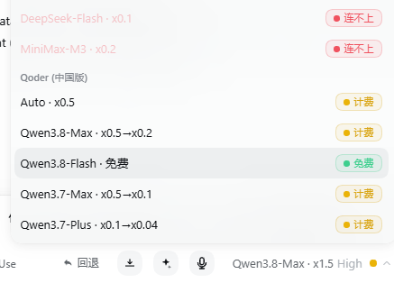
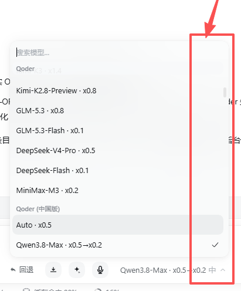

# dsh-ofm-extension — 模型测活矩阵

> DeepSeek Harness (DSH) 插件：把模型选择器里的**每一个模型**真实测一遍，
> 用四种颜色标注可用性与计费属性，徽标在每行**尾部对齐**。



*修复后的模型下拉：`Qwen3.8-Flash · 免费` → 绿（可用·免费），`x0.5` 倍率行 → 黄（可用·计费），连不上的路由 → 红。*



*修复前：状态列空白，无任何标注。*

## 作用

本插件扫描 DSH 模型下拉菜单里的所有可用模型，逐个实测连通性与计费属性，把结果以**彩色徽标**直接标注在模型名字**尾部对齐**的位置，让用户一眼看出哪些模型能用、哪些用不了、哪些免费、哪些要花积分/钱。

四色标注：

| 颜色 | 含义 | 典型来源 |
| --- | --- | --- |
| 🟢 绿 | 可用 · 免费 | ping 成功且属免费车道 / 目录标注「免费」/ OFM Kilo 免费车道 |
| 🟡 黄 | 可用 · 消耗费用或积分 | ping 成功且带积分倍率（`x0.1`、`x0.5→x0.2`）/ 共付车道 / 自带 key |
| ⚪ 灰 | 不可用 · 积分或费用不足 | `QUOTA` / `ACCOUNT_QUOTA` / `Insufficient Balance` / 免费额度用完 |
| 🔴 红 | 不可用 · 无法连接 | `TRANSPORT` / `TIMEOUT` / 地区封锁 / DNS 失败 / 整个 provider 目录读取失败 |

## 为什么做这个插件

主要是因为 **[Our Free Model](https://github.com/Ebony-Vinyl/dsh-our-free-model)** 提供了大量“白嫖模型”——免密、免费或低成本的模型通道。但白嫖模型好用不好用、能不能连上、会不会突然收积分，没有一个可信的实测答案。本插件就是为了把这些白嫖模型一个一个真实测过，把可用性与计费属性直接标在模型选项里，省去逐个摸索。

## 它做了什么

1. **目录**：`ctx.llm.listProviders() × listModels()` —— 与模型选择器完全同源的候选清单，一个不漏。
2. **判定（三层，越上层越省钱）**：
   - **复用 [Our Free Model](https://github.com/Ebony-Vinyl/dsh-our-free-model) 的实测结果**：直接读它持久化的 `availability.json`（它已逐模型真实 ping 过并记录 state/detail），零额外请求、零额外费用；
   - **目录措辞**：名字里的「免费」/`free`/积分倍率 `x0.1` 等（含 CJK 边界修正）；
   - **自带 ping（深度测试）**：对没有实测记录的行发一条 `maxTokens:16` 的最小请求，同时接住 throw 与流内 `finish{kind:'error'}` 两种失败形态（防止“200 流里报配额”被误判可用）。
3. **呈现**：
   - 模型下拉的每一行尾部追加四色徽标（`MutationObserver` 装饰 portal 菜单），触发器按钮带同色圆点；
   - 设置页「模型测活」面板：四色计数、分 provider 矩阵（状态列定宽、尾部对齐）、进度条、停止按钮、超时设置。
4. **持久化**：`$DSH_HOME/model-probe/results.json`；分类器升级自带迁移（不重新 ping）。

## 安装

```bash
# 方式一：dsh CLI（推荐）
dsh plugin --profile desktop add github:seikuronya/dsh-ofm-extension

# 方式二：手动
git clone https://github.com/seikuronya/dsh-ofm-extension \
  ~/.dsh/profiles/desktop/node_modules/dsh-ofm-extension
# 然后在 ~/.dsh/profiles/desktop/package.json 的
#   dependencies 加 "dsh-ofm-extension": "file:./node_modules/dsh-ofm-extension"
#   dsh.profile.bundles 加 "dsh-ofm-extension"
# 重启 DSH
```

重启后 6 秒自动跑一轮（先读目录，结果过期才后台全量 ping，默认 6 小时新鲜度保护，不会反复烧额度）。

## HTTP API（同源 + 信任围栏）

| 路由 | 说明 |
| --- | --- |
| `GET /api/model-probe/summary` | 矩阵 + 四色计数 + 进度 + OFM 复用状态 |
| `POST /api/model-probe/run` | `{deep, background}` 触发一轮 |
| `POST /api/model-probe/stop` | 中止当前轮 |
| `POST /api/model-probe/settings` | `{deepTest, pingTimeoutMs}` |

## 测试

```bash
node tests/smoke.mjs    # 分类逻辑 27 断言（含 CJK 回归、真实 OFM 数据折叠）
node tests/mount.mjs    # 挂载冒烟：假 ctx 全流程 + HTTP 围栏（临时 DSH_HOME，隔离）
node tests/migrate.mjs  # 分类器版本迁移：旧结果就地重算，零 ping
```

## 致谢

- **[Our Free Model](https://github.com/Ebony-Vinyl/dsh-our-free-model)** —— 作者 [@Ebony-Vinyl](https://github.com/Ebony-Vinyl)。本插件的判定基石与直接动机来源。它提供的免密免费车道与逐模型实测持久化，让“白嫖模型哪些真能用”第一次有了可信答案；本插件直接复用它的 `availability.json` / `catalog.json`，并对它的作者致以诚挚感谢。没有 OFM 的白嫖模型池，就没有做这个插件的动机。
- **DeepSeek Harness** —— 插件运行平台（cordis 服务、`ctx.llm` 路由、webServer、设置页槽位）。

## 制作说明

本插件由 **seikuronya** 使用 **DeepSeek Harness** 制作，AI 协作模型为 **Qwen3.8**。

人机协作分工：

- **Qwen3.8**：承担架构调研、DSH 宿主 API（`ctx.llm`、`webServer`、`cordis` bundle 补丁）逆向与定位、核心代码编写（宿主半边 `index.js`、客户端半边 `client.js`、分类器 `src/classify.js`、探测 `src/ping.js`、信任围栏 `src/trust.js`）、测试用例编写（`tests/`）与桌面端验证。
- **我（Little Code Sauce / DSH 任务执行器）**：在 Qwen3.8 生成方案的基础上，负责具体落地执行——源码整合与修复（如 CJK「免费」边界匹配 bug）、桌面环境部署与卸载、桌面备份与恢复、独立单文件 bundle 打包、GitHub 仓库创建、改名对齐、topic 设置、Git Data API 推送远端，以及本说明文档的撰写。

简言之：Qwen3.8 负责“怎么做”与代码方案，我负责“把它跑起来并交付到你的桌面与仓库里”。

## License

MIT
